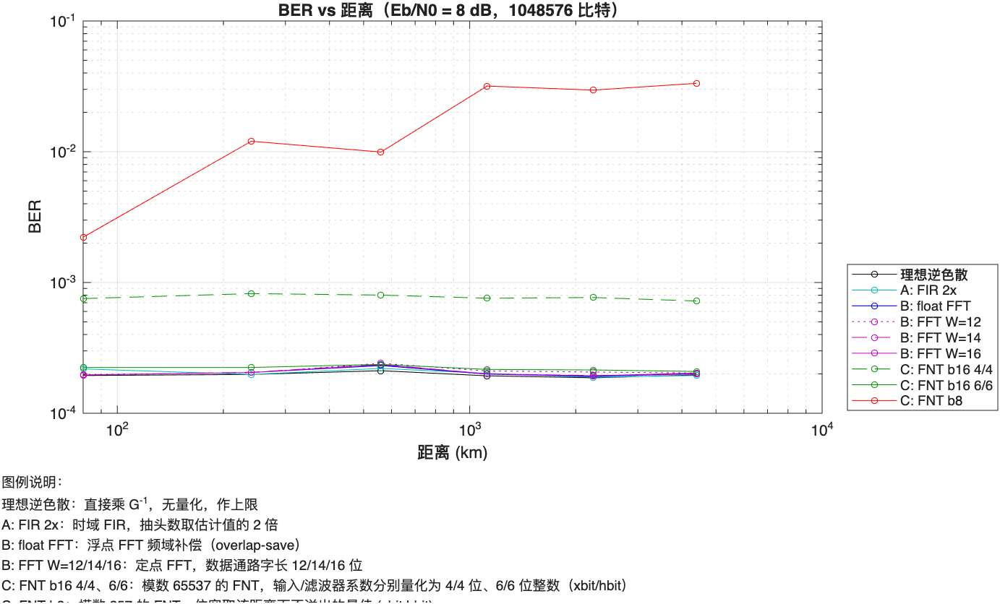
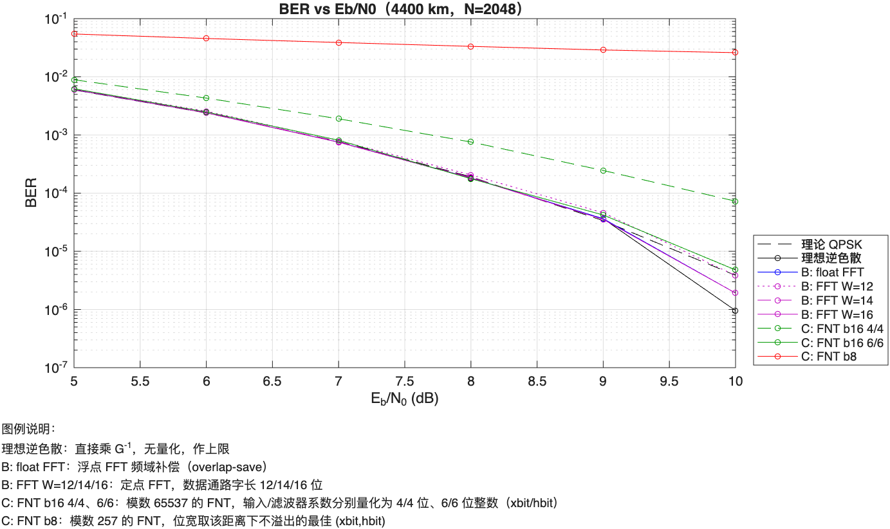
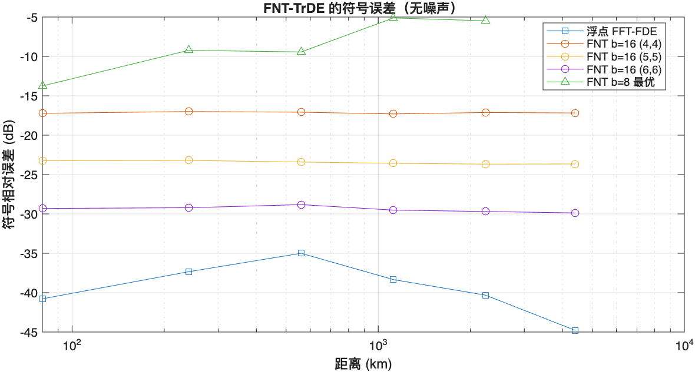
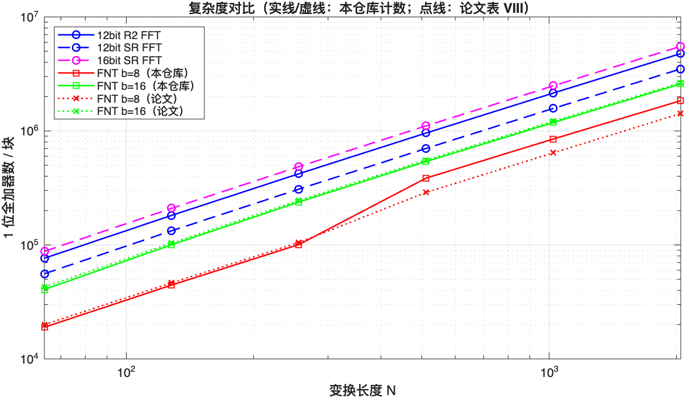
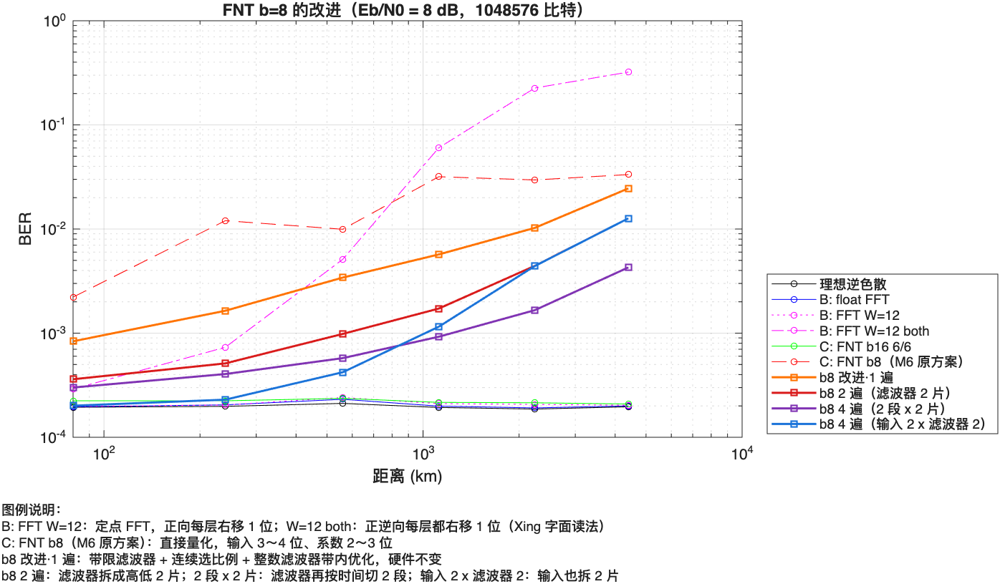
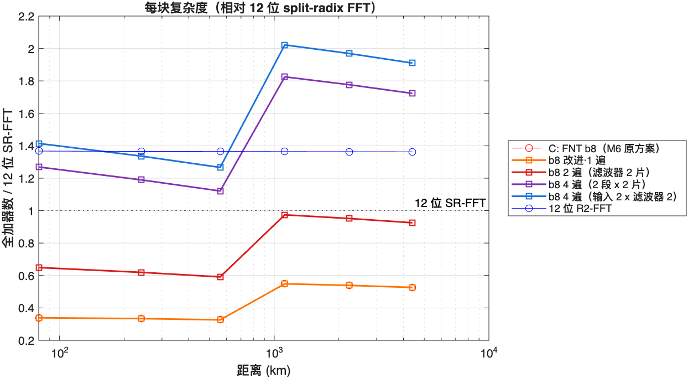

# FNT / FFT / 时域 三种静态色散补偿的对比仿真：总结报告

日期：2026-11-23　　参考论文：Xing 等，*Low-Complexity Chromatic Dispersion Compensation Using Fermat Number Transform*，JLT 42(15) 5190 (2024)

> 本报告里的数字都是本仓库的仿真/计数结果。与论文的对照在正文里明确标出；没复现的地方如实写出，没有为了凑结果调参。

---

## 1. 目的

按师兄的安排，先实现 FNT，再与 FFT、时域方案对比，之后才做 AEQ。本阶段回答三个问题：

1. 三种静态色散补偿在 BER 上差多少？
2. 定点 FFT 和 FNT 各需要多少位才不损失性能？
3. 复杂度（1 位全加器数）能省多少？与 Xing 论文是否一致？

## 2. 仿真设定

| 项目 | 取值 | 说明 |
|---|---|---|
| 信号 | 56 Gbit/s，QPSK（Gray），28 GBaud | 符号率由比特率推算 |
| 采样 | 2 SPS，$f_s=56$ GSa/s | 直接在 2 SPS 生成，不另做重采样 |
| 脉冲成形 | 根升余弦，滚降 0.2，跨度 20 符号 | **暂定值**（论文未见，待确认） |
| 光纤 | $D=17$ ps/nm/km，$\lambda=1550$ nm | 只有色散，无非线性 |
| 距离 / 块长 $N$ | 80/240/560/1120/2240/4400 km ↔ 64/128/256/512/1024/2048 | 同 Xing 第 VI 节 |
| 分块 | overlap-save，50% 重叠 | |
| 噪声 | 加性高斯白噪声，按 $E_b/N_0$ 设定 | **自设**，工作点 8 dB |
| 比特数 | $2^{20}\approx10^6$（M6） | 8 dB 时约 200 个误码 |
| BER 统计 | 丢弃首尾各 1000 个符号 | 避开圆卷积边缘 |

色散在频域是纯相位项 $G(z,\omega)=\exp(-j\beta_2 z\omega^2/2)$，补偿就是乘 $G^{-1}$。接收端先补偿，再匹配滤波、下采样、判决，所有方案共用同一份接收序列（同一份噪声），差异只来自补偿方法。

## 3. 实现了哪些算法

| 方案 | 实现 | 要点 |
|---|---|---|
| 理想逆色散 | 整段 FFT 乘 $G^{-1}$ | 无量化，作上限 |
| **A 时域 FIR** | `eq_fir` | 滤波器 = $G^{-1}$ 的 IFFT 取中心；抽头数取估计值的 2 倍 |
| **B FFT-FDE（浮点）** | `eq_fdc_fft` | overlap-save，$N$ 点 FFT，乘 $H$，IFFT，丢掉重叠部分 |
| **B FFT-FDE（定点）** | `eq_fdc_fft_fixed` | $W$ 位整数；旋转因子、$H$ 取 $W-2$ 位小数；正向每层右移 1 位，逆向不缩放；溢出饱和并计数 |
| **C FNT-TrDE** | `eq_fdc_fnt` + `fnt/` | 模 $q=2^b+1$（257、65537）的整数变换；实/虚部各做 FNT，QRNS 把复数乘变成 2 次实数乘；$N>2^b$ 用 2D-FNT |
| 复杂度计数 | `complexity/` | 按 Xing 第 IV、VI 节规则数 1 位全加器 |

FNT 的核心是：模 $2^b+1$ 下 $2^b\equiv-1$，所以乘 2 的幂只是移位和取反，旋转因子是 2 或 $\sqrt2$ 的幂时变换里不需要乘法，而且结果是整数精确的（没有舍入误差，只有输入/系数的量化误差）。代价是数值范围被模数限死，$b=8$ 时只有 $\pm128$。

每个模块都有验收脚本（`tests/test_m1.m … test_m7.m`），全部通过。

## 4. 结果

### 4.1 BER（M6）

$E_b/N_0=8$ dB，6 个距离，BER：

| 方案 | 80 km | 560 km | 4400 km |
|---|---|---|---|
| 理想逆色散 | 1.9e-4 | 2.1e-4 | 2.0e-4 |
| A FIR（2×抽头） | 2.2e-4 | 2.2e-4 | 1.9e-4 |
| B 浮点 FFT | 2.0e-4 | 2.3e-4 | 2.0e-4 |
| B 定点 FFT $W=12$ | 2.0e-4 | 2.4e-4 | 2.0e-4 |
| B 定点 FFT $W=16$ | 2.0e-4 | 2.4e-4 | 2.0e-4 |
| C FNT $b=16$，6/6 位 | 2.2e-4 | 2.4e-4 | 2.1e-4 |
| C FNT $b=16$，4/4 位 | 7.5e-4 | 8.0e-4 | 7.2e-4 |
| C FNT $b=8$（每个距离搜最佳位宽） | 2.2e-3 | 9.9e-3 | 3.3e-2 |

（100 万比特时 $10^{-4}$ 量级的 BER 有约 7% 的统计涨落，同行里 ±10% 的差别不是真实差别。）



4400 km 下，达到目标 BER 所需的 $E_b/N_0$ 及相对浮点 FFT 的代价：

| 方案 | BER $10^{-3}$ | BER $10^{-4}$ |
|---|---|---|
| 理想逆色散 / 浮点 FFT | 6.75 / 6.76 dB | 8.37 / 8.37 dB |
| 定点 FFT $W=12$ | +0.05 dB | +0.11 dB |
| 定点 FFT $W=14$、16 | ≈0 | ≈0 |
| FNT $b=16$，6/6 位 | +0.06 dB | +0.02 dB |
| FNT $b=16$，4/4 位 | +0.94 dB | +1.36 dB |
| FNT $b=8$ | 达不到（到 10 dB 仍 $>10^{-2}$） | 达不到 |



### 4.2 量化精度（M4、M5，无噪声的符号误差）

- 浮点 FFT 的符号误差约 −35～−45 dB，是计数上限。
- 定点 FFT：$W=16$ 与浮点相同；$W=12$ 在 $N=64$ 时 −39 dB，$N=2048$ 时只有 −29 dB（$N$ 越大每层丢位越多）。四舍五入与截断相差 $<0.3$ dB。
- FNT $b=16$：(4,4) 位 ≈ −17 dB，(5,5) ≈ −23.5 dB，(6,6) ≈ −29.5 dB，每多一位改善约 6 dB。"(xbit,hbit)" 指输入和滤波器系数各量化成几位整数。
- FNT $b=8$：$N\ge256$ 时只能取 2～3 位系数，符号误差 −5～−14 dB。



### 4.3 复杂度（M7，每个 overlap-save 块的 1 位全加器数）

规则按 Xing 第 IV、VI 节：复数乘 = 3 实乘 + 3 实加；$W$ 位实乘 = $W/3$ 次加；$W$ 位加 = $W$ 个全加器。

- **FFT（R2 与 SR，12～16 位，$N=64\sim2048$）共 60 项与 Xing 表 VIII 全部吻合，相对差 $<0.5\%$**（表里只有 3 位有效数字，等于逐位复现），说明计数方法与论文一致。
- FNT 1D-HR：$b=16$ 全部 $N$ 比论文低 2.5%～4.9%；$b=8$ 的 $N=64/128/256$ 低 4.1%～5.3%。
- FNT $b=8$ 的 2D 情形（$N=512/1024/2048$）：比论文**高** 30%～34%，因为没实现 Xing 第 V-C 节的 2D 优化，是偏保守的上界。

| 对比 | 本仓库节省 | 论文 |
|---|---|---|
| FNT $b=16$ vs 16 位 SR-FFT | 51%～54% | 约 51% |
| FNT $b=8$ vs 12 位 R2-FFT，$N\le256$ | 75%～76% | 约 72% |
| FNT $b=8$ vs 12 位 R2-FFT，$N\ge512$ | 60%～61% | 约 72% |
| FNT $b=8$ vs 12 位 SR-FFT，$N\le256$ | 66%～67% | 约 62% |
| FNT $b=8$ vs 12 位 SR-FFT，$N\ge512$ | 45%～47% | 约 62% |



## 5. 结论

1. FIR（抽头数取估计值的 2 倍）、浮点 FFT、定点 FFT（$W\ge14$）、FNT $b=16$（6/6 位）在 BER 上与理想逆色散没有显著差别。
2. **FNT $b=16$ 复现了论文的结论**：BER 等同浮点 FFT，复杂度比 16 位 SR-FFT 省约一半。输入/系数位数不能太少：4/4 位要多付约 1 dB，6/6 位才无代价。
3. 定点 FFT 位宽要求随 $N$ 增大而变高，$W=12$ 在 $N=2048$ 有可见的精度损失（4400 km 约 +0.1 dB），$W\ge14$ 基本无损。
4. **FNT $b=8$ 的复杂度优势成立，精度要看和谁比**。重读论文图 19 发现：论文自己的 $b=8$ 在 240 km 起也只有 $10^{-3}\sim10^{-1}$，论文的 12 位 FFT 在 560 km 起同样崩溃（与"正逆向每层都截位"一致）。所以"$b=8$ 与 12 位 FFT 相当"成立的前提是 12 位 FFT 用了很粗的截位；与合理缩放的 12 位 FFT 比，$b=8$ 差很多。
5. **$b=8$ 可以改进**（第 7 节）：不加硬件 BER 好 1.4～7 倍；≤240 km 用 4 遍可到浮点水平，但成本与 12 位 R2-FFT 相当；长距离靠 $b=8$ 解决不了，应该用 $b=16$。

## 6. 没做出来的和局限

### 6.1 FNT $b=8$ 的精度问题，及可能原因

$q=257$ 时所有中间值必须在 $\pm128$ 内才不溢出。色散滤波器很长，N 项乘积之和要装进这个范围，只能把输入压到约 3 位、系数压到 2～3 位，量化噪声大。

这个限制与位数怎么分配无关：卷积结果约为 输入幅度 × 系数幅度 × $\sqrt{\text{抽头数}}$，抽头数由色散决定。论文图 19 里它自己的 $b=8$ 在 240 km 起也很差，说明论文并没有绕过这个限制（读图判断）。

### 6.2 其他局限

1. **噪声模型是自设的**：只有高斯白噪声；没有相位噪声、频偏、ADC 量化；工作点 8 dB 是我挑的。
2. **符号率、滚降系数、"时域方案"的含义是暂定的**；FIR 抽头数是我按带宽估的 2 倍，不是论文值。
3. **定点 FFT 的截位规则是我选的**：论文字面是"每层截 1 位，逐点乘后去掉低 $b$ 位"。我试了字面读法（逆向也每层右移，最后左移 $\log_2N$ 位恢复）：$W=16$ 在 4400 km 多付约 1 dB，$W=12$ 在 2240 km 以上直接崩溃（BER≈0.3），原因是逆向每层丢位，最后左移又把累积的截断噪声放大 $N$ 倍。所以主结果用"只在正向每层右移"。论文的真实做法未知，这影响 $W=12$ 的结论。
4. **复杂度**：没计入模约简、D1 转换、旋转因子表存储和控制逻辑；FNT 1D 比论文低 2.5%～5% 的原因没查清；2D 未做论文的优化。
5. **统计**：BER $<10^{-5}$ 时 100 万比特里只有个位数误码，$E_b/N_0\ge9$ dB 处的曲线是统计噪声，不能当结论。
6. 单偏振、色散量精确已知，因此**没有做色散估计误差容限**（Xing 图 20/21），也**没有 AEQ**。

## 7. $b=8$ 改进探索（补充）

**做法**（实现：`fnt_mp_design` 离线设计，`eq_fdc_fnt_mp` 用真正的 FNT 执行，`run_b8_improve.m`）：

- 不加硬件：带限滤波器（只在信号带宽内等于 $G^{-1}$），输入比例连续选（在另一组标定数据上），整数滤波器带内优化（逐抽头 ±1，把量化误差推到带外）。
- 多遍：滤波器或输入拆成高低两片，或滤波器按时间切段，每遍各做一次不溢出的 FNT 卷积，结果在普通整数里精确加回去。精度上去了，代价是多做几次逆 FNT。

**结果**（$E_b/N_0=8$ dB，与第 4 节同一份噪声）：

| 方案 | 80 km | 240 km | 560 km | 4400 km | 成本 / 12 位 SR-FFT |
|---|---|---|---|---|---|
| 理想逆色散 | 1.9e-4 | 2.0e-4 | 2.1e-4 | 2.0e-4 | — |
| 12 位 FFT，论文式截位（正逆向每层截） | 2.9e-4 | 7.3e-4 | 5.1e-3 | 3.2e-1 | 1.37（R2） |
| $b=8$ 原方案 | 2.2e-3 | 1.2e-2 | 9.9e-3 | 3.3e-2 | 0.33～0.53 |
| $b=8$ 改进·1 遍 | 8.4e-4 | 1.6e-3 | 3.4e-3 | 2.5e-2 | 0.33～0.53 |
| $b=8$ 2 遍（滤波器 2 片） | 3.6e-4 | 5.1e-4 | 9.8e-4 | 1.3e-2 | 0.59～0.93 |
| $b=8$ 4 遍（输入 2 × 滤波器 2） | **2.0e-4** | **2.3e-4** | 4.2e-4 | 1.3e-2 | 1.27～1.91 |
| $b=8$ 4 遍（2 段 × 2 片） | 3.0e-4 | 4.1e-4 | 5.8e-4 | 4.3e-3 | 1.12～1.72 |





**结论**：$b=8$ 适合短距离。≤240 km 做到浮点水平需要 4 遍，成本与 12 位 R2-FFT 相当；2 遍是折中（成本约 12 位 SR-FFT 的 0.6）。长距离应该用 $b=16$。所有改进方案在 ≥560 km 都好于论文式截位的 12 位 FFT。全部细节见 README 第 9 节。


## 8. 要向师兄确认的问题

1. 定点 FFT 的截位规则：论文图 19 的 12 位 FFT 在 560 km 起崩溃，与"正逆向每层都截"一致，是不是就是这样做的？
2. $b=8$ 的量化细节；以及组里是否关心短距离（≤240 km）的 $b=8$ 多遍方案。
3. 组里实际用的参数：滚降系数、"时域方案"指什么、OSNR 或 $E_b/N_0$ 工作点。
4. 复杂度计数是否包含 D1 转换、模约简？
5. 下一步优先做什么：补 2D 优化、色散估计误差容限，还是直接接 AEQ？

## 9. 复现

```bash
cd fnt_cd_comparison
matlab -batch "run('tests/test_m1.m'); run('tests/test_m2.m'); run('tests/test_m3.m'); run('tests/test_m4.m'); run('tests/test_m5.m'); run('tests/test_m7.m'); run('tests/test_b8.m')"
matlab -batch "run('run_ber_sweep.m')"      # M6，约 50 s，输出 outputs/m6_*
matlab -batch "run('run_complexity.m')"     # M7，输出 outputs/m7_*
matlab -batch "run('run_b8_improve.m')"     # b=8 改进探索，约 2 分钟，输出 outputs/b8_*
```

随机种子固定在 `cfg_fnt_cd.m` 的 `cfg.seed`。所有参数集中在 `cfg_fnt_cd.m`，各模块的细节和每步结果见 `README.md` 第 5～8 节。

## 10. 文件索引

| 位置 | 内容 |
|---|---|
| `cfg_fnt_cd.m`、`setup_paths.m` | 参数与路径 |
| `channel/` | 发射、色散信道、加噪 |
| `rx/` | 接收判决、BER 评分 |
| `equalizer/` | 方案 A、B（浮点/定点）、C |
| `fnt/` | FNT 核心（1D、2D、QRNS、D1、取值提升） |
| `complexity/` | 复杂度计数 |
| `tests/` | 各模块验收脚本 |
| `run_ber_sweep.m`、`run_complexity.m`、`run_b8_improve.m` | M6、M7 主脚本，b=8 改进探索 |
| `outputs/` | 图与结果数据 |
| `README.md` | 完整计划、每步结果、待确认事项 |
